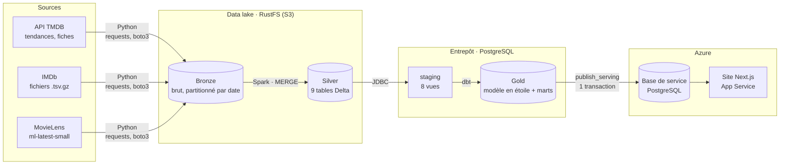
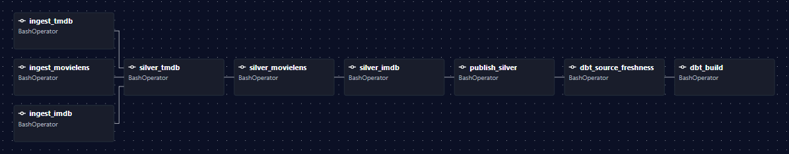
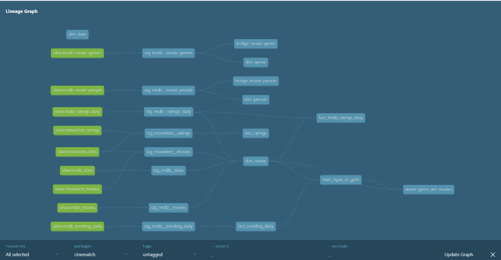

<div align="center">

# 🎬 CineMatch

**Quel film vaut vraiment la peine d'être regardé ce soir, par moi ou par nous ?**

Une plateforme de données de bout en bout, de l'API brute jusqu'au site en ligne.

[](https://github.com/kawthar-khayet/CineMatch/actions/workflows/ci.yml)


### 🌐 [cinematch.azurewebsites.net](https://cinematch.azurewebsites.net)

</div>

---

CineMatch collecte chaque jour des données de films (**TMDB, IMDb, MovieLens**), les transforme dans une
architecture médaillon (**Spark, Delta Lake, dbt**) orchestrée par **Airflow**, puis les publie vers un site
**Next.js hébergé sur Azure**. Le site répond à deux questions :

- **Le buzz de ce film est-il mérité ?** L'indice « Hype ou Pépite » croise les tendances du jour et les notes IMDb.
- **Que regarder ce soir ?** Un moteur de recommandation hybride et explicable, pour une personne ou pour un groupe.


## Sommaire

- [En bref](#en-bref)
- [Architecture](#architecture)
- [Le pipeline quotidien](#le-pipeline-quotidien)
- [Le modèle de données](#le-modèle-de-données)
- [L'indice « Hype ou Pépite »](#lindice--hype-ou-pépite-)
- [La recommandation, seul ou en groupe](#la-recommandation-seul-ou-en-groupe)
- [Le site et la couche de service](#le-site-et-la-couche-de-service)
- [Démarrage rapide](#démarrage-rapide)
- [Qualité et intégration continue](#qualité-et-intégration-continue)
- [Organisation du dépôt](#organisation-du-dépôt)
- [État du projet et suite](#état-du-projet-et-suite)
- [Documentation](#documentation)
- [Sources de données et licences](#sources-de-données-et-licences)

---

## En bref

| | |
|---|---|
| **Sources** | 3 : API TMDB, fichiers officiels IMDb, MovieLens |
| **Volume** | ~1,7 million de notes IMDb lues par jour, 100 836 notes MovieLens (610 utilisateurs) |
| **Catalogue** | 9 753 titres dans `dim_movie`, 2 348 films recommandables |
| **Lakehouse** | 9 tables Silver en Delta Lake, écrites par `MERGE` |
| **Entrepôt** | Modèle en étoile : 4 dimensions, 2 ponts, 3 faits (dont 2 incrémentaux), 2 marts |
| **Qualité** | 81 modèles et tests dbt, contrôle de fraîcheur des sources, un test métier |
| **Orchestration** | 1 DAG Airflow de 11 tâches, chaque jour à 6 h UTC, idempotent |
| **Produit** | Site Next.js sur Azure, mis à jour par le pipeline sans redéploiement |

---

## Architecture



L'ensemble est piloté par le DAG Airflow `cinematch_batch_daily`. Deux styles de transformation cohabitent,
chacun là où il est le plus adapté : **ETL** avec Spark jusqu'à Silver (JSON imbriqué, gros fichiers),
**ELT** avec dbt jusqu'à Gold (SQL, tests, lignage).

| Rôle | Outil | Pourquoi |
|---|---|---|
| Ingestion | Python 3.11 (`requests`, `boto3`) | Simple, testable, sans dépendance lourde |
| Data lake | **RustFS 1.0** (compatible S3) | Même protocole qu'un stockage cloud : aucun code à changer pour migrer |
| Format de tables | **Delta Lake 3.2** | Transactions ACID et `MERGE` sur des fichiers |
| Traitement | **Spark 3.5** (PySpark) | Aplatissement du JSON, typage, harmonisation des identifiants |
| Entrepôt | **PostgreSQL 16** | Suffisant pour ce volume, universel |
| Modélisation et tests | **dbt 1.12** (+ `dbt_utils`) | SQL versionné, tests, documentation et lignage générés |
| Orchestration | **Airflow 3.3** (LocalExecutor) | Planification, reprises, journal de chaque tâche |
| Site | **Next.js 16**, React 19, Tailwind CSS 4 | Pages pré-générées, cache rafraîchi à la demande |
| Hébergement | **Azure** App Service + PostgreSQL | Infrastructure créée par scripts (`infra/azure/`) |
| Conteneurs et CI | Docker Compose, GitHub Actions | Tout démarre avec une commande ; chaque push est vérifié |

Chaque choix est justifié dans les [décisions d'architecture (ADR)](docs/adr/) ; les versions exactes et leurs
contraintes de compatibilité sont dans [docs/versions.md](docs/versions.md).

---

## Le pipeline quotidien



| Étape | Tâches | Ce qui se passe |
|---|---|---|
| 1. Ingestion → Bronze | `ingest_tmdb`, `ingest_imdb`, `ingest_movielens`, `ingest_tmdb_catalog` | Appels HTTP en parallèle, fichiers bruts déposés dans le lake, partitionnés par date |
| 2. Bronze → Silver | `silver_tmdb`, `silver_movielens`, `silver_imdb` | Spark, une tâche à la fois pour tenir dans la mémoire d'un portable ; écriture Delta par `MERGE` |
| 3. Silver → Postgres | `publish_silver` | Copie des tables Delta dans le schéma `silver` de l'entrepôt |
| 4. Gold | `dbt_source_freshness`, `dbt_build` | Contrôle de fraîcheur, puis modèles et tests dans l'ordre du lignage |
| 5. Service | `publish_serving` | Publication vers la base Azure, puis notification du site |

Les principes appliqués partout :

- **Idempotence.** Chaque tâche reçoit la date du run (`{{ ds }}`) : relancer un jour retraite la même partition,
  sans doublon.
- **Incrémental.** `MERGE` Delta côté Spark, modèles `incremental` côté dbt, et seules les fiches TMDB manquantes
  sont redemandées à l'API.
- **Résilience.** 2 reprises automatiques espacées de 5 minutes, délai maximal d'une heure par tâche,
  un seul run actif à la fois.
- **Isolation.** Chaque tâche lance son module dans son propre processus : Spark démarre et s'arrête avec elle,
  ce qui libère la mémoire ([ADR 0002](docs/adr/0002-spark-local-dans-airflow.md)).

---

## Le modèle de données



En vert, les tables Silver publiées par Spark ; puis la couche staging, le modèle en étoile,
l'indice « Hype ou Pépite » et le test métier qui le vérifie.

| Type | Tables |
|---|---|
| Dimensions | `dim_movie`, `dim_person`, `dim_genre`, `dim_date` |
| Ponts (plusieurs-à-plusieurs) | `bridge_movie_genre`, `bridge_movie_person` |
| Faits | `fact_ratings`, `fact_trending_daily` ⟳, `fact_imdb_ratings_daily` ⟳ |
| Marts | `mart_hype_or_gem`, `mart_movie_features` |

⟳ modèle incrémental. Le détail de chaque colonne est dans le [dictionnaire de données](docs/data_dictionary.md).

---

## L'indice « Hype ou Pépite »

Les plateformes recommandent surtout ce qui est déjà populaire, sans dire si le buzz est mérité.
L'indice croise le **buzz** (présence dans les tendances TMDB du jour) et la **qualité** (note et votes IMDb) :

| Catégorie | Règle |
|---|---|
| 🔥 **Vraie tendance** | En tendance et noté au moins 7/10 |
| ⚠️ **Buzz trompeur** | En tendance mais noté moins de 6/10 |
| 😐 Avis partagés | En tendance, noté entre 6 et 7/10 |
| ⏳ Pas encore noté | En tendance, sans note IMDb ou avec moins de 1 000 votes (souvent une sortie récente) |
| 💎 **Pépite cachée** | Hors tendance, un film noté au moins 8/10 avec 5 000 à 50 000 votes |

Les trois premières catégories exigent au moins 1 000 votes IMDb, pour que la note soit fiable.

Les seuils sont des variables dbt (`dbt_project.yml`), et chaque film classé reçoit une explication générée
par le modèle, dans la langue du site : *« #1 trending, and well rated: 8.0/10 on IMDb »*.

> **Une histoire de qualité des données.** La première version passait tous les tests, mais l'analyse des
> résultats a montré que les « pépites » étaient surtout des épisodes de séries. Le type de contenu IMDb a été
> ingéré, les règles resserrées et un test métier ajouté (`assert_gems_are_movies`) : les pépites sont passées
> de **1 019 à 138, toutes des films**. Des tests verts ne prouvent pas que le résultat a du sens.

Run du 2026-10-08 : 138 pépites cachées, 36 vraies tendances, 21 buzz trompeurs.

---

## La recommandation, seul ou en groupe

Sur la page **Recommend**, chacun indique ce qu'il aime : des films, des réalisateurs, des acteurs, des genres.

| Part du score | Poids | Calcul |
|---|---|---|
| Contenu | 40 % | Genres (50 %), réalisateur (30 %) et acteurs (20 %) en commun avec ses goûts |
| Collaboratif | 40 % | Similarité avec le film aimé le plus proche, d'après les notes MovieLens |
| Qualité | 20 % | Note IMDb, de 5/10 (0) à 9/10 (1) |

- **Le collaboratif est calculé par le pipeline** ([`collaborative.py`](data-platform/src/cinematch/recommendation/collaborative.py)) :
  similarité cosinus entre films sur les notes centrées par utilisateur, pondérée par le nombre de spectateurs
  communs (*shrinkage*), 20 voisins gardés par film.
- **Le score est calculé dans le navigateur** ([`recommend.ts`](frontend/src/lib/recommend.ts)), sur un catalogue
  chargé une fois : le résultat s'actualise à chaque clic, sans aller-retour avec le serveur.
- **Chaque suggestion est expliquée** : *« Directed by Christopher Nolan, like The Dark Knight »*,
  *« Viewers who loved Inception also loved it »*.
- **En groupe**, chaque membre est noté séparément et ses scores sont normalisés, pour que chacun pèse autant.
  Deux stratégies : la **moyenne**, ou la **moindre déception** (le film dont le membre le moins content
  l'est le moins possible).

---

## Le site et la couche de service

| Page | Contenu |
|---|---|
| [`/`](https://cinematch.azurewebsites.net) | Date des tendances, chiffres clés, trois rangées de films |
| [`/hype-check`](https://cinematch.azurewebsites.net/hype-check) | Tous les films classés : filtre par catégorie, recherche, tri |
| `/film/[id]` | Fiche d'un film : verdict et explication, notes, rang tendance, équipe |
| [`/recommend`](https://cinematch.azurewebsites.net/recommend) | Recommandation pour une personne ou un groupe |

Le site ne se connecte jamais à l'entrepôt et ne contient aucune logique métier : il lit une **base de service**
séparée, qui ne contient que ce qu'il affiche.

1. La tâche `publish_serving` remplace les tables `serving.*` **en une seule transaction** : le site ne voit
   jamais une table à moitié remplie.
2. Elle appelle ensuite `POST /api/revalidate` avec un secret partagé : le cache du site est invalidé aussitôt.
3. Sans cet appel (machine éteinte, réseau coupé), le site se rafraîchit de lui-même au bout d'une heure
   et continue d'afficher la dernière publication.

L'infrastructure Azure est reproductible : trois scripts PowerShell dans [`infra/azure/`](infra/azure/)
(base, App Service, déploiement) et un workflow GitHub Actions qui redéploie le site à chaque modification
de `frontend/`.

---

## Démarrage rapide

**Prérequis :** Docker Desktop (8 Go de mémoire conseillés) et un jeton d'API TMDB
([gratuit](https://www.themoviedb.org/settings/api)).

```bash
git clone https://github.com/kawthar-khayet/CineMatch.git
cd CineMatch
cp .env.example .env        # puis remplir : jeton TMDB, mots de passe, clé Airflow
docker compose up -d        # RustFS, Postgres et Airflow
```

1. Ouvrir Airflow sur http://localhost:8080 (compte `AIRFLOW_ADMIN_USER` / `AIRFLOW_ADMIN_PASSWORD` du `.env`).
2. Activer le DAG `cinematch_batch_daily` : le premier run démarre aussitôt. Compter une dizaine de minutes
   pour celui-ci, qui récupère environ 2 300 fiches TMDB (le bucket du data lake est créé automatiquement).
3. Lire les résultats dans Postgres (`localhost:5433`, schéma `marts`), par exemple `mart_hype_or_gem`.

| Service | Adresse |
|---|---|
| Airflow | http://localhost:8080 |
| Console RustFS (data lake) | http://localhost:9001 |
| API S3 | http://localhost:9000 |
| PostgreSQL (entrepôt) | `localhost:5433` |

> La tâche `publish_serving` a besoin de `SERVING_DATABASE_URL` (une base Postgres hébergée).
> Sans elle, tout le pipeline jusqu'à Gold fonctionne ; seule cette dernière tâche échoue.

<details>
<summary><b>Lancer une étape à la main (débogage)</b></summary>

```bash
# Environnement Python local, une seule fois
python -m venv .venv && source .venv/bin/activate    # Windows : .venv\Scripts\activate
pip install -r requirements.txt && pip install -e .

# 1. Ingestion → Bronze
python -m cinematch.ingestion.tmdb --pages 5
python -m cinematch.ingestion.imdb
python -m cinematch.ingestion.movielens

# 2. Bronze → Silver (Spark, dans Docker) — silver_imdb en dernier
docker compose run --rm spark-jobs python -m cinematch.transform.silver_tmdb --date AAAA-MM-JJ
docker compose run --rm spark-jobs python -m cinematch.transform.silver_movielens
docker compose run --rm spark-jobs python -m cinematch.transform.silver_imdb --date AAAA-MM-JJ

# 3. Silver → Postgres
docker compose run --rm spark-jobs python -m cinematch.transform.publish_silver

# 4. Gold (dbt), puis documentation et lignage sur http://localhost:8081
dotenv run -- dbt build
dotenv run -- dbt docs generate
dotenv run -- dbt docs serve --port 8081
```

</details>

<details>
<summary><b>Lancer le site en local</b></summary>

Node.js 24 et une base de service déjà remplie par `publish_serving` sont nécessaires.

```bash
cd frontend
echo "DATABASE_URL=postgresql://..." > .env.local    # la même valeur que SERVING_DATABASE_URL
npm install
npm run dev                                          # http://localhost:3000
```

</details>

---

## Qualité et intégration continue

| Niveau | Contrôle |
|---|---|
| Ingestion | Échec si trop de fiches TMDB sont en erreur, ou si le fichier IMDb reçu est invalide |
| Sources dbt | Fraîcheur : avertissement si les données ont plus de 2 jours |
| Modèles dbt | Unicité (simple et composée), non-nullité, relations entre tables, valeurs acceptées |
| Métier | `assert_gems_are_movies` : une pépite doit être un film |
| Code Python | `ruff check` et `ruff format --check` à chaque push |
| Projet dbt | `dbt parse --warn-error` à chaque push : un avertissement fait échouer la CI |
| Site | `eslint` puis build avant chaque déploiement |

---

## Organisation du dépôt

```
CineMatch/
├── data-platform/
│   ├── src/cinematch/        Code Python du pipeline
│   │   ├── ingestion/          TMDB, IMDb, MovieLens → Bronze
│   │   ├── transform/          Spark : Bronze → Silver (Delta), publication dans Postgres
│   │   ├── recommendation/     Filtrage collaboratif item-item
│   │   └── serving/            Gold → base de service, notification du site
│   ├── dbt/                  Staging, modèle en étoile, marts, tests
│   ├── airflow/dags/         DAG cinematch_batch_daily
│   ├── docker/               Images Airflow et Spark, initialisation de Postgres
│   └── databricks/           Portage Databricks (à venir, ADR 0003)
├── frontend/                 Site Next.js
├── infra/azure/              Scripts de création et de déploiement Azure
├── docs/                     ADR, dictionnaire de données, récapitulatifs par étape
├── .github/workflows/        CI et déploiement du site
└── docker-compose.yml        RustFS, Postgres, Airflow, Spark
```

---

## État du projet et suite

| | Élément |
|---|---|
| ✅ | Pipeline batch quotidien, de l'ingestion à Gold |
| ✅ | Indice « Hype ou Pépite » v1.1, avec test métier |
| ✅ | Couche de service et site en ligne sur Azure |
| ✅ | Recommandation hybride et explicable, individuelle et de groupe |
| ✅ | CI (ruff, dbt) et déploiement automatisé du site |
| 🔜 | Évaluation hors ligne de la recommandation, sur des notes MovieLens mises de côté |
| 🔜 | Tests unitaires Python et test d'intégration des DAGs |
| 🔜 | Pipeline autonome : une machine Azure allumée une heure par jour, au lieu d'un PC |
| 🔜 | Indice v2 : la **progression** du buzz plutôt que la simple présence en tendance |
| 🔜 | Historique de `dim_movie` (SCD2 par snapshot dbt), alertes en cas d'échec d'un run |
| 💡 | Streaming d'événements avec Kafka, tableaux de bord Metabase, API FastAPI, portage Databricks |

Les dossiers `backend/`, `databricks/`, `streaming/`, `evaluation/`, `tests/` et `dbt/models/_later/` contiennent la structure
prévue pour ces étapes ; ils ne sont pas encore implémentés. Le détail est dans la [feuille de route](docs/roadmap.md).

---

## Documentation

| Document | Contenu |
|---|---|
| [ARCHITECTURE.md](ARCHITECTURE.md) | Architecture cible complète |
| [Vue d'ensemble du pipeline](docs/recap/00-vue-ensemble-pipeline.md) | Synthèse, chiffres clés, incidents résolus |
| [Récapitulatifs 01 à 07](docs/recap/) | Chaque étape expliquée : ingestion, Spark, dbt, Airflow, site |
| [Décisions d'architecture](docs/adr/) | Lakehouse et entrepôt, Spark dans Airflow, Databricks, Airflow plutôt que Dagster |
| [Dictionnaire de données](docs/data_dictionary.md) | Sources, tables Silver, harmonisation des identifiants |
| [Versions et compatibilités](docs/versions.md) | Versions fixées et contraintes entre elles |
| [Feuille de route](docs/roadmap.md) | Ce qui est fait, ce qui reste |

---

## Sources de données et licences

| Source | Données | Conditions |
|---|---|---|
| [TMDB](https://www.themoviedb.org/) | Tendances du jour, fiches, affiches | *This product uses the TMDB API but is not endorsed or certified by TMDB.* |
| [IMDb](https://developer.imdb.com/non-commercial-datasets/) | `title.ratings`, `title.basics` | IMDb Non-Commercial Datasets, usage non commercial |
| [MovieLens](https://grouplens.org/datasets/movielens/) | `ml-latest-small` | GroupLens Research, usage de recherche et d'enseignement |

---

<div align="center">

Réalisé par **Kawthar Khayet** · [Voir le site](https://cinematch.azurewebsites.net) · [Code source](https://github.com/kawthar-khayet/CineMatch)

</div>
